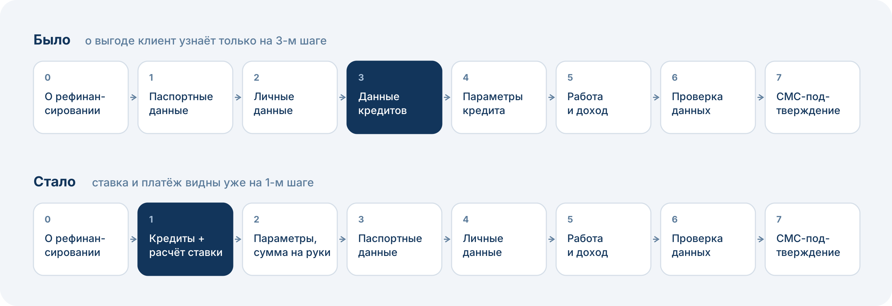
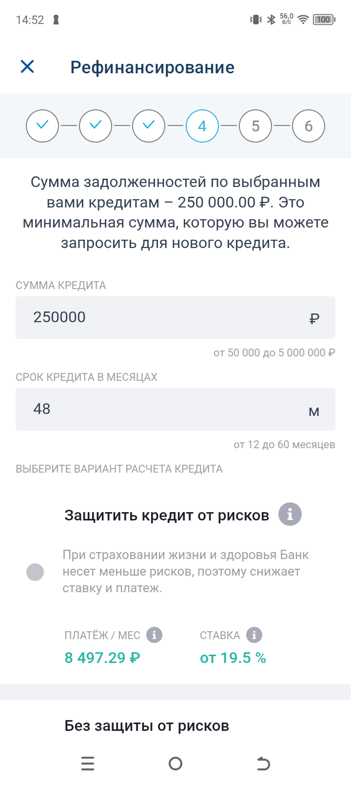
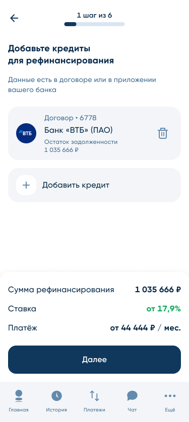
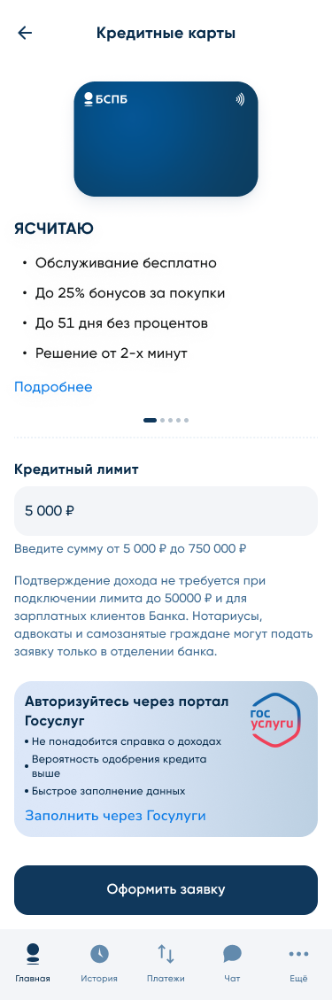
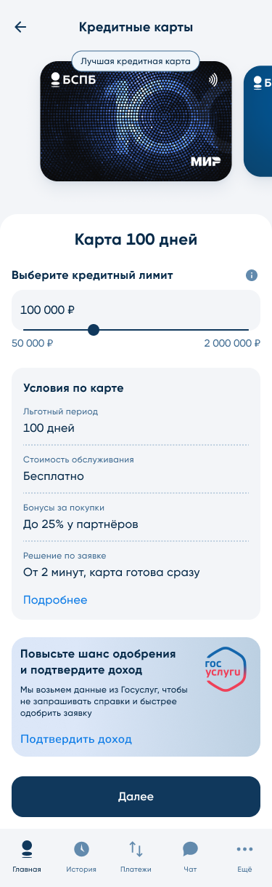

## Контекст

Три кредитных продукта (кредитная карта, рефинансирование, потребительский кредит) в каналах PWA и Android. У каждого продукта своя воронка заявки.

Запрос стейкхолдера был техническим: перевести заявку в Android на нативную реализацию. Я увидел, что в рамках этой доработки можно за небольшую стоимость заметно поднять конверсию, и предложил расширить задачу.

Работа велась на общем пуле ресурсов: системные аналитики, разработка, тестирование и дизайн — четыре отдельные функциональные команды.

**Ограничения:**

- требования ЦБ и методологов: часть полей нельзя убрать;
- архитектура: удалить или объединить шаги без длительной доработки невозможно.

## Проблема

По данным Яндекс Метрики, SQL-выгрузок, CustDev и обращений в поддержку я выделил три главные точки оттока.

**Рефинансирование: клиент не видит выгоду до 3-го шага.** Сначала заявка просит паспорт и личные данные и ничего не говорит о ставке. При этом главный вопрос клиента — «сколько я буду платить после рефинансирования».

**Рефинансирование: тяжёлое заполнение кредитов.** В среднем клиент рефинансирует 3–4 кредита, это 15–25 полей. И всё это без обратной связи о будущей ставке.

**Кредитная карта: клиент не замечает ключевые элементы.** Пользователи пропускали выбор суммы, выбор между двумя картами и баннер подключения Госуслуг.

**Общее для всех продуктов:** перегруженные шаги «Работа и доходы» и «Проверка данных», редкие поля, в которых клиенты ошибались.

## Задача

Максимально поднять конверсию в отправку заявки минимальными ресурсами, в рамках требований ЦБ, методологов и текущей архитектуры.

## Discovery

**Очевидные решения** подтверждались и данными, и рыночной практикой. Например, перенос заполнения кредитов в начало заявки рефинансирования: так устроены заявки у большинства игроков рынка, и это прямо отвечает на главный вопрос клиента.

**Спорные решения** прорабатывались через альтернативы. Для заполнения кредитов было два направления: UX-упрощение ручного ввода и автоматическая подгрузка кредитов. Я выбрал **масштабируемый вариант**: интерфейс, удобный для ручного ввода сейчас и готовый к автоподгрузке кредитов в следующей итерации.

**Приоритизация по ICE.** Дорогие в разработке гипотезы вынес в отдельный бэклог со своей приоритизацией, гипотезы с сомнительным эффектом отбросил.

## Решение

### Общие изменения для всех продуктов

- Убрал неиспользуемые поля на шаге «Работа и доходы».
- Скрыл ИНН, СНИЛС и «Иные расходы» в раскрывающиеся блоки. Это снижает нагрузку на клиента и количество ошибок в данных, а значит повышает одобрение.
- На шаге «Проверка данных» оставил на виду только параметры продукта, ФИО и паспорт, остальное свернул по шагам.
- Переработал баннер подключения Госуслуг, чтобы повысить кликабельность. Данные Госуслуг повышают качество заявок и долю одобрений.

### Рефинансирование

- Перенёс заполнение кредитов и выбор параметров рефинансирования в начало заявки, до паспортных и личных данных.
- Упростил добавление и отображение кредитов, добавил предварительный расчёт ставки и ежемесячного платежа: клиент видит выгоду до ввода личных данных.
- Выделил отдельное поле «Сумма на руки». Раньше клиент менял общую сумму кредита и косвенно получал сумму на руки.
- Сократил и переформатировал тексты на стартовом экране.

### Кредитная карта

- Поднял выбор суммы лимита выше на экране.
- Добавил визуал, показывающий выбор между двумя картами.
- Сократил и переформатировал тексты на стартовом экране.

### Потребительский кредит

- Применил общие изменения на пересекающихся шагах.
- Запустил функцию «Продолжите заполнение заявки»: в течение 3 дней клиент видит напоминание о брошенной заявке.

**Как работал с ограничениями.** По каждому полю проходили согласование с рисками и методологами. Что было допустимо — убрал, что нельзя убрать — скрыл в раскрывающиеся блоки.

Запускал поэтапно: сначала кредитная карта, затем рефинансирование. На второй волне разбил доработки на мелкие задачи, чтобы команды брали их в свободные окна, а не ждали очереди на крупный блок. **Срок реализации второй волны сократился в 1,5 раза.**

## Результат

| Продукт | Отправка заявки | Одобрение |
|---|---|---|
| Кредитная карта | 28,9% → **34%** | 15% → **16%** |
| Рефинансирование | 11,7% → **15%** | 30% → **31%** |
| Потребительский кредит | **+1 п.п.** · **+7%** отправленных заявок от «Продолжите заполнение» | без изменений |

**Продажи кредитных продуктов в цифровых каналах:** **[ЗАПОЛНИТЬ: X%]**.

**Как измеряли:** сравнение до/после, очищенное от эффекта маркетинговых кампаний и изменения ставок. Изменения по продуктам выходили в разное время: пока менялась заявка по кредитной карте, конверсия в рефинансировании не менялась. Это подтверждает, что рост связан именно с доработками.

Рост отправленных заявок не снизил их качество: одобрение выросло, конверсия из одобрения в выдачу не изменилась.

**Дальше:** автоподгрузка кредитов для рефинансирования, доработка рисковой модели по кредитным картам, расширение использования данных Госуслуг.

## Выводы

- **Крупную доработку стоит делить на мелкие задачи с самого начала.** На общем пуле ресурсов это решающий фактор: мелкие задачи проходят через свободные окна команд, крупные ждут очереди. На второй волне это ускорило реализацию в 1,5 раза.
- **Терпимость к длинной заявке зависит от ценности продукта.** К рефинансированию клиенты относятся серьёзнее и готовы заполнять больше полей, а конверсия в подключение Госуслуг там в 2–3 раза выше, чем в других продуктах. Значит, упрощать нужно по-разному: в рефинансировании важнее рано показать выгоду, чем сократить поля.
