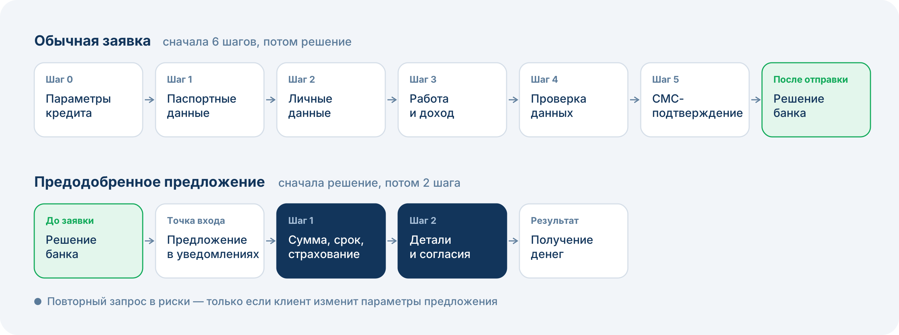
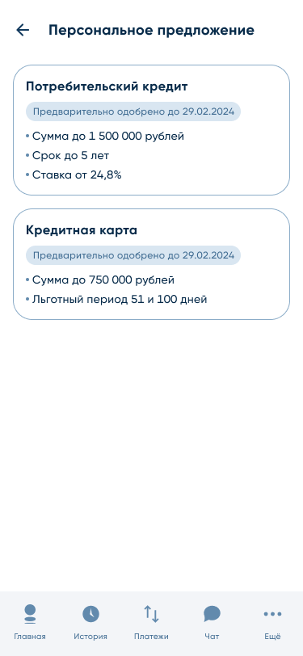
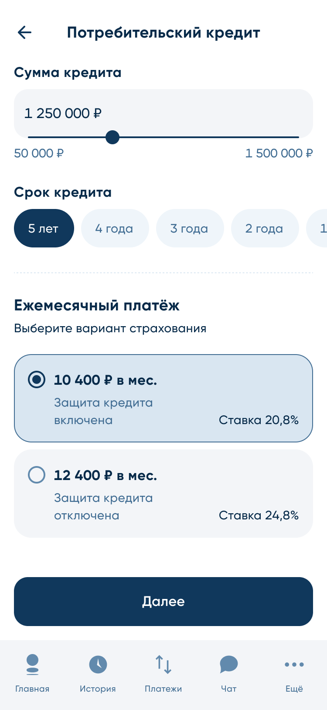

## Контекст

Банк Санкт-Петербург входит в топ-20 банков РФ, MAU более 1 млн. Я отвечаю за развитие кредитных продуктов в цифровых каналах.

Предодобренные предложения работали только в нативном Android-приложении. Клиенты PWA их не видели, а через PWA банк обслуживает большую часть пользователей iOS, около 10% пользователей Android и desktop-версию (ещё 3% клиентов). Моя задача — вывести продукт в PWA для трёх направлений (потребительский кредит, кредитная карта, рефинансирование), а затем расширить базу клиентов, которым доступно предложение.

**Ограничения:** регуляторные требования, требования риск-менеджмента, ограниченная база клиентов с полным набором данных для расчёта предложения.

## Проблема

Клиенты PWA, даже те, о ком банк уже всё знает, проходили обычную кредитную заявку: **6 шагов и около 30 полей**.

- Конверсия от старта обычной заявки до выдачи: **[ЗАПОЛНИТЬ: X%]**
- Бросают заявку, не отправив: **88,3%**
- Получают отказ из отправленных: **70%**

Банк тратил ресурс клиента на сбор данных, которые у него уже были, и терял большую часть людей ещё до решения.

## Задача

Запрос кредитного бизнеса: растить выдачи на текущей клиентской базе. Рамки: без бюджета на привлечение и без изменения риск-политики.

## Discovery

Рассмотрел три направления, которые уже доказали эффективность на рынке:

1. Сокращение шагов обычной заявки за счёт автозаполнения данными Госуслуг
2. Доработка рисковой модели
3. Отдельная короткая заявка для клиентов с предодобренным предложением

Выбрал короткую заявку для предодобренных клиентов: максимальный эффект на уже известный сегмент при минимальном риске и стоимости. Механика была проверена в Android, поэтому её вывод в PWA давал быстрый и предсказуемый результат. Сокращение шагов обычной заявки через Госуслуги — следующий этап, сейчас в работе.

Для старта выделил **«бесплатный» сегмент**: около 12% пользователей, по которым у банка есть все параметры для расчёта предложения и все нужные согласия. Это позволило запуститься без новых интеграций для сбора данных и без дополнительных согласований с рисками.

## Решение

### Этап 1. Запуск в PWA

Новый флоу:

1. Банк заранее рассчитывает предложение по тем же рисковым моделям, что и для обычной заявки: решение принято до того, как клиент начал оформление
2. Клиент видит персональное предложение в уведомлениях
3. Короткая заявка, шаг 1: сумма, срок, вариант страхования
4. Короткая заявка, шаг 2: проверка деталей и согласия
5. Получение денег

Повторный запрос в риски уходит, только если клиент меняет параметры предложения.

Что я делал:

- определил скоуп и формат реализации: какие системы участвуют и как обмениваются данными (это была основная сложность проекта);
- выбрал модель с минимальным риском, поэтому согласование с риск-менеджментом прошло без затяжек;
- запустил пилот через канареечную раскатку, а затем раскатил на весь сегмент.

### Этап 2. Расширение базы через Госуслуги (ЕСИА)

Данные Госуслуг в банке уже были, но использовались только внутри кредитной заявки. Я увидел, что их можно переиспользовать для расчёта предодобренных предложений: именно этих данных не хватало, чтобы предложение получила большая часть клиентов.

- спроектировал переиспользование данных ЕСИА для скоринга предложений;
- добавил отдельную точку сбора данных Госуслуг вне кредитной заявки;
- провёл согласование с юристами и ИБ: около месяца до финального решения.

Статус: в разработке, запуск до конца 2026.

## Результат

| Метрика | Обычная заявка | Короткая заявка |
|---|---|---|
| Конверсия «старт → выдача» | **[ЗАПОЛНИТЬ: X%]** | **13,5%** |
| Шагов в заявке | 6 (~30 полей) | **2** |
| Выдачи в цифровых каналах | — | **+7%** |
| Затраты на привлечение | — | без роста: коммуникации только внутри приложения |
| Риск-метрики | — | без изменений: те же рисковые модели |

**Прогноз по ЕСИА** (экономическая модель): +20% к базе предложений, +1,5% к выдачам.

**Дальше:** показ предложений на главном экране, новые каналы коммуникаций, использование предложений в офисах, расширение применения данных Госуслуг.

## Выводы

- **Согласования нужно запускать параллельно.** Юристов, ИБ и интеграцию с Госуслугами стоило подключать одновременно, а не последовательно. Это сократило бы этап проектирования.
- **У каждого продукта свой клиент.** Портреты клиентов потребкредита, рефинансирования и кредитной карты заметно различаются, и предложения стоит строить под каждый сегмент.
- **«Нужно» работает лучше, чем «выгодно».** Клиенты нормально реагируют на подсвечивание выгоды, но заметно охотнее предоставляют данные, когда шаг подан как обязательный.
